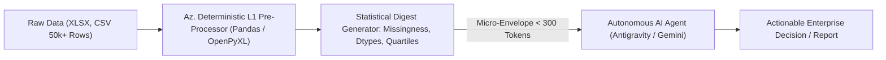

# Az. DataEngine: Zero-Token Local Spreadsheet Analytics for Autonomous AI

[](https://opensource.org/licenses/MIT)
[](#)
[](#)
[](#)

---

## 1. The Core Problem (For Business Leaders and Beginners)

Uploading 20MB Excel workbooks or customer CSVs into AI chatbots is costly, slow, and exposes sensitive company data. A single corporate sheet burns 50,000+ tokens just to answer simple questions like "What was Q3 revenue?" or "Where are the data discrepancies?"

**The Az. Consultancy Approach:**
* **Never send raw tabular data to an external LLM.**
* Run local, deterministic Python/Pandas compute on your own infrastructure ($0.00 token cost).
* Pass only a mathematically distilled statistical micro-envelope (<300 tokens) to the AI model.

---

## 2. Technical Architecture (For Data Scientists and AI Engineers)

Large language models process tabular data with significant token overhead and unpredictable hallucination rates across row-column bindings. 

Az. DataEngine acts as an L1 deterministic middleware between enterprise data stores (Excel, CSV, TSV) and autonomous LLM agents (Google Antigravity, Gemini, Claude).



### Key Capabilities:
- **Zero Token Tabular Ingestion:** Parse multi-sheet Excel files locally with sub-second latency.
- **Automated Data Hygiene:** Compute exact missingness, column distribution, null counts, and summary statistics.
- **Crash-Proof Design:** Graceful error handling and headless execution built for continuous production pipelines.

---

## 3. Quickstart

### Installation
```bash
git clone https://github.com/Amz34/az-zero-token-data-engine.git
cd az-zero-token-data-engine
pip install pandas openpyxl
```

### Usage
Generate a distilled, token-free analytical summary:
```bash
python3 scripts/data_analyzer.py sample_financials.xlsx --pretty
```

---

## 4. Enterprise Services & Consulting (KSA & GCC)

Az. Consultancy deploys secure, self-hosted autonomous agent pipelines, bilingual WhatsApp/web assistants, and zero-token enterprise data architectures for enterprises across the Kingdom of Saudi Arabia.

* **Corporate Site & Case Studies:** Connect with Az. Consultancy for custom AI integrations.
* **Architecture Audits:** Cut corporate LLM API bills by 80%+ while preserving data privacy.

---

## License
MIT © Az. Consultancy

---

Part of [my always-on agent stack](https://github.com/Amz34) · [Awesome Agent Infrastructure](https://github.com/Amz34/awesome-agent-infrastructure) (135 live-checked building blocks).
